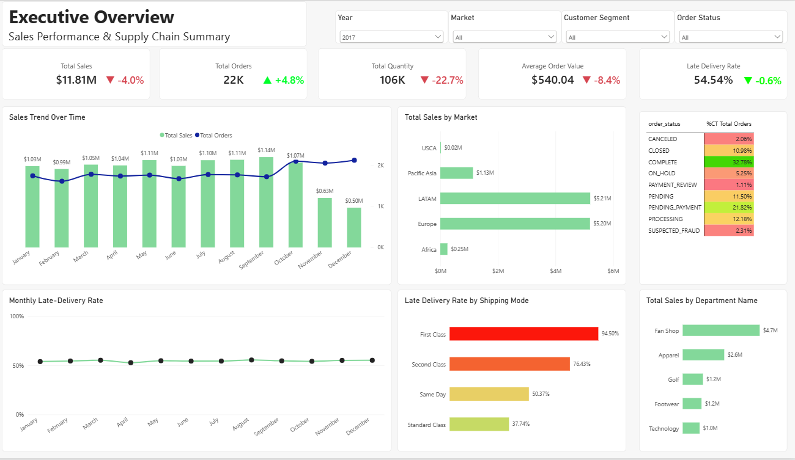
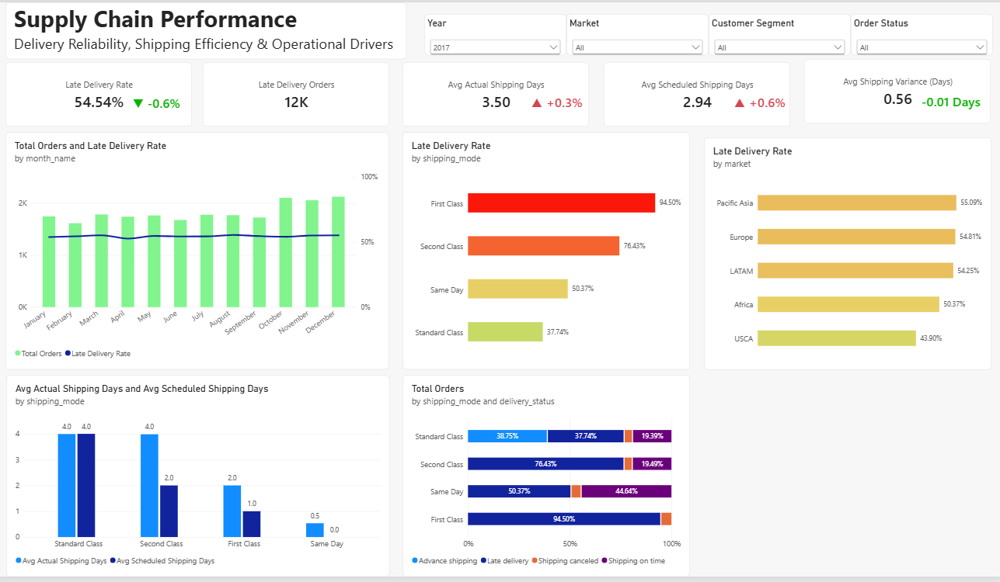
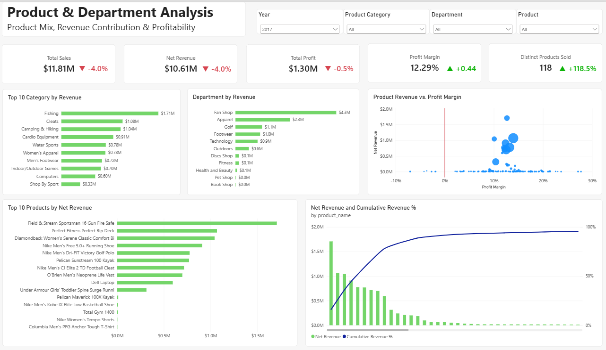
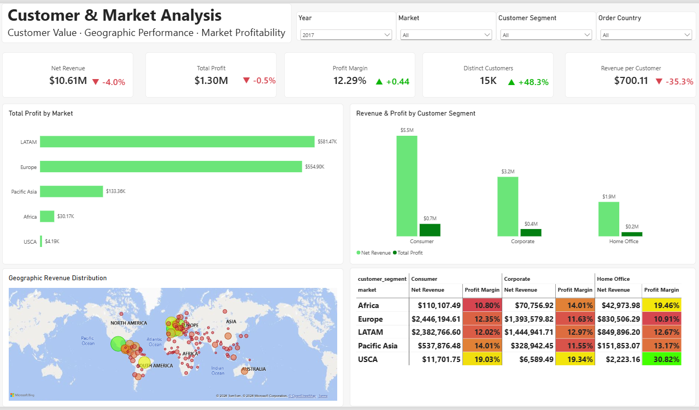

# Supply Chain Performance Investigation
### Data Analytics Portfolio Project | DataCo Supply Chain (2015–2017)

An end-to-end supply chain analytics project using Python, Jupyter Notebook, Power BI, and business reporting to investigate commercial performance, delivery reliability, product profitability, and customer value.

The objective is not simply to visualize KPIs, but to identify meaningful patterns, investigate anomalies, and translate evidence into actionable management recommendations.

---

## Table of Contents

- [Project Overview](#project-overview)
- [Business Questions](#business-questions)
- [Tools and Technologies](#tools-and-technologies)
- [Project Workflow](#project-workflow)
- [Power BI Dashboard](#power-bi-dashboard)
- [Key Findings](#key-findings)
- [Data Quality and Analytical Limitations](#data-quality-and-analytical-limitations)
- [Management Recommendations](#management-recommendations)
- [Repository Structure](#repository-structure)
- [How to Reproduce the Analysis](#how-to-reproduce-the-analysis)
- [Skills Demonstrated](#skills-demonstrated)
- [Author](#author)

---

## Project Overview

Supply chain teams need to balance commercial performance, profitability, customer value, and delivery reliability. This project investigates these dimensions using the DataCo Supply Chain dataset covering 2015–2017.

The project combines data preparation in Python, a star-schema-style data model, interactive Power BI dashboards, year-over-year comparisons, and a management investigation report.

**Primary objective:** Transform operational and commercial data into reliable insights that support supply chain and business decisions.

## Business Questions

1. How did sales, order volume, quantity sold, and average order value change between 2015 and 2017?
2. Why did sales weaken in 2017 despite an increase in order volume?
3. Which shipping modes have the highest reported late-delivery rates?
4. How do product and department performance differ when revenue and profitability are considered together?
5. How do customer segments and destination markets contribute to revenue and profit?
6. Which unusual trends require data validation before management takes action?

## Tools and Technologies

| Tool | Application |
|---|---|
| Python | Data preparation, cleaning, and investigation |
| Pandas | Data manipulation and aggregation |
| Jupyter Notebook | Reproducible analysis and documentation |
| Power BI | Data modeling, DAX measures, interactive dashboards |
| DAX | KPI calculations and analytical measures |
| CSV | Data exchange between preparation and reporting stages |
| Microsoft Word / PDF | Management report preparation and communication |
| Git and GitHub | Version control and project portfolio presentation |

## Project Workflow

### 1. Data Preparation

- Loaded the original DataCo dataset.
- Inspected data structure, column quality, and missing values.
- Prepared cleaned datasets for analytical modeling.
- Separated order-level and order-item-level data.
- Created dimension tables to support analytical slicing and filtering.

### 2. Data Modeling

Developed a star-schema-style model containing two fact tables:

- `fact_orders` — order-level information.
- `fact_order_items` — order-item-level quantities, sales, revenue, and profit fields.

Supporting dimensions include customer, product, category, department, destination, date, shipping, and order status.

Metric calculations must respect the grain of each table to avoid incorrect counts or duplicated values.

### 3. Power BI Development

Built four dashboard pages:

- **Executive Overview** — sales, orders, quantity, average order value, and headline performance.


- **Supply Chain Performance** — delivery reliability, shipping times, and shipping-mode comparisons.


- **Product & Department Analysis** — product mix, revenue, profit, and margin.


- **Customer & Market Analysis** — customer segments, destination markets, and market profitability.



### 4. Investigation and Reporting

Used dashboard results to identify unusual movements, frame follow-up questions, compare performance across years, and develop management recommendations.

The report distinguishes observed dashboard results from potential explanations that require additional validation.

## Power BI Dashboard

The report covers four analytical perspectives:

| Dashboard | Main purpose |
|---|---|
| Executive Overview | Assess overall commercial performance |
| Supply Chain Performance | Investigate delivery reliability |
| Product & Department Analysis | Evaluate revenue and profitability |
| Customer & Market Analysis | Examine customer and geographic performance |

**Dashboard file:** `Supply_Chain_Dashboard.pbix`

Open the PBIX file using Microsoft Power BI Desktop.

*Add screenshots of the dashboard pages here to make the project easier to explore on GitHub.*

## Key Findings

The following findings are based on the current Power BI dashboard outputs and should be interpreted in light of the data-quality checks described below.

### 1. Commercial Performance Weakened in 2017

The dashboard reports:

- Total Sales declined from approximately **$12.30M in 2016 to $11.81M in 2017**, a decrease of about 4.0%.
- Order volume increased by approximately 4.8%.
- Quantity sold declined by approximately 22.7%.
- Average order value declined to approximately $540.

This shows that an increase in orders did not translate into higher sales. The reduction in quantity sold and average order value warrants further investigation.

### 2. Delivery Reliability Remained a Major Concern

The dashboard reports late-delivery rates of:

- **2016:** 55.12%
- **2017:** 54.54%

In 2017, First Class had a reported late-delivery rate of 94.50%, while Second Class had 76.43%.

These results identify shipping modes that warrant investigation. They do not, by themselves, establish that the shipping modes caused the delays.

### 3. Profitability Was More Resilient Than Sales

The dashboard reports approximately $1.30M in total profit for 2017, with a profit margin of 12.29%.

The reported margin improved even as sales declined. Product-level margin and contribution should therefore be considered alongside revenue when reviewing assortment, promotions, and inventory decisions.

### 4. Customer Growth Did Not Translate into Higher Revenue per Customer

The customer dashboard reports approximately 15,000 distinct customers in 2017, an increase of 48.3%, while revenue per customer declined by 35.3% to approximately $700.

The definitions, date filters, and customer-count logic should be checked before interpreting these figures as a genuine change in customer behavior.

### 5. Late-2017 Sales Pattern Requires Validation

The November–December 2017 data shows an unusual pattern: order counts remain comparatively high while revenue falls sharply, and the cleaned data has one item row and one unit per order in both months.

This could reflect a genuine change or a data completeness, transformation, or source issue. The raw records must be reconciled with the cleaned exports before drawing a business conclusion.

## Data Quality and Analytical Limitations

A central principle of this project is that **a dashboard result is a signal to investigate, not automatically an explanation**.

The following checks are particularly important:

- Reconcile November and December 2017 order-item records against the raw source.
- Investigate the unusually large shift in reported market sales and profit between 2016 and 2017.
- Confirm that year-over-year comparisons use consistent definitions, filters, and relationships.
- Verify customer-count and revenue-per-customer calculations.
- Validate late-delivery outcomes against shipment dates and scheduled delivery dates.
- Check whether the late-delivery risk field and delivery-status field encode the same outcome.
- Document the definitions of Total Sales, Net Revenue, Total Profit, and Profit Margin.

The analysis is descriptive and diagnostic. It does not establish causal relationships unless further evidence supports them.

## Management Recommendations

Based on the current findings, the proposed priorities are:

1. **Validate data integrity first.** Reconcile unusual late-2017 patterns and market movements before allocating resources based on those results.
2. **Investigate delivery reliability.** Examine First Class and Second Class performance by market, month, order profile, and relevant shipment dates.
3. **Investigate order and customer value.** If the commercial decline is confirmed, analyze revenue per order, units per order, product mix, and customer segments.
4. **Protect profitability.** Review product-level revenue, profit, and margin together before changing pricing, promotions, or inventory commitments.
5. **Establish consistent KPI monitoring.** Define metric formulas, assign ownership, and review commercial and operational performance regularly.

These recommendations are proposed actions, not claims that the underlying causes have already been established.

## Repository Structure

The intended repository structure is:

```text
supply-chain-performance-investigation/
├── README.md
├── notebooks/
│   └── data_preparation_and_investigation.ipynb
├── data/
│   ├── raw/                 # Excluded from Git if large or restricted
│   └── cleaned/             # Include only appropriate, non-sensitive files
├── powerbi/
│   └── Supply_Chain_Dashboard.pbix
├── reports/
│   ├── Supply_Chain_Performance_Report.pdf
│   └── Supply_Chain_Performance_Report.docx
├── images/
│   ├── executive_overview.png
│   ├── supply_chain_performance.png
│   ├── product_department_analysis.png
│   └── customer_market_analysis.png
└── .gitignore
```

Adjust this structure to match the files actually committed to the repository. Do not commit duplicate files merely to match this example.

## How to Reproduce the Analysis

1. Clone or download this repository.
2. Install Python and the required packages.
3. Open the Jupyter Notebook and review the preparation and analysis steps.
4. Run the notebook cells in order, updating file paths as necessary.
5. Open the Power BI file in Power BI Desktop.
6. If prompted, update data-source paths to the cleaned CSV files.
7. Refresh the model and compare the resulting measures with the report.

Example environment setup:

```bash
pip install pandas numpy matplotlib seaborn jupyter
jupyter notebook
```

The packages listed above are a starting point; update them to match the notebook's actual imports.

## Skills Demonstrated

- Supply chain performance analysis
- Data cleaning and quality investigation
- Dimensional modeling and fact-table grain
- Power BI dashboard design
- DAX measures and KPI development
- Year-over-year performance analysis
- Delivery reliability analysis
- Product profitability and customer-value analysis
- Business reporting and management recommendations
- Analytical documentation and reproducibility

## Author

**Achraf Noui**

Aspiring Supply Chain Analyst focused on data-driven decision-making, supply chain performance, and business analytics.

---

*This project is an independent analytical portfolio project using the DataCo Supply Chain dataset. Findings are based on the available dataset and dashboard outputs; anomalies are explicitly identified for validation rather than presented as confirmed business causes.*
